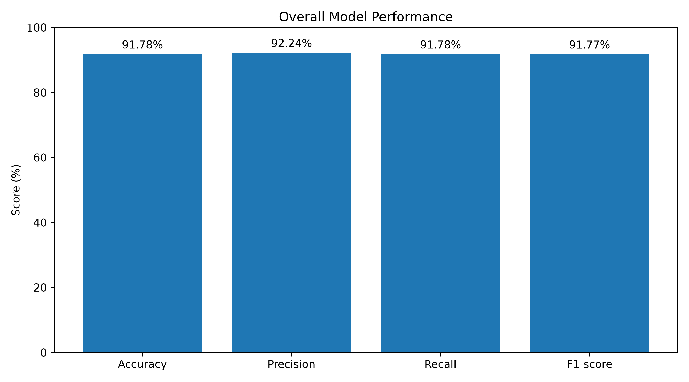
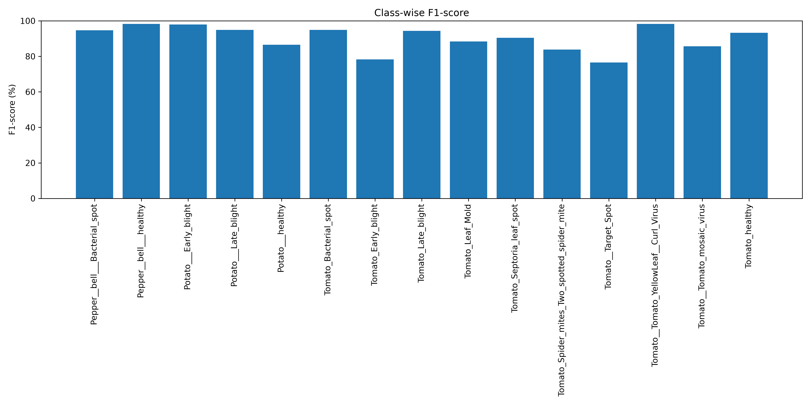
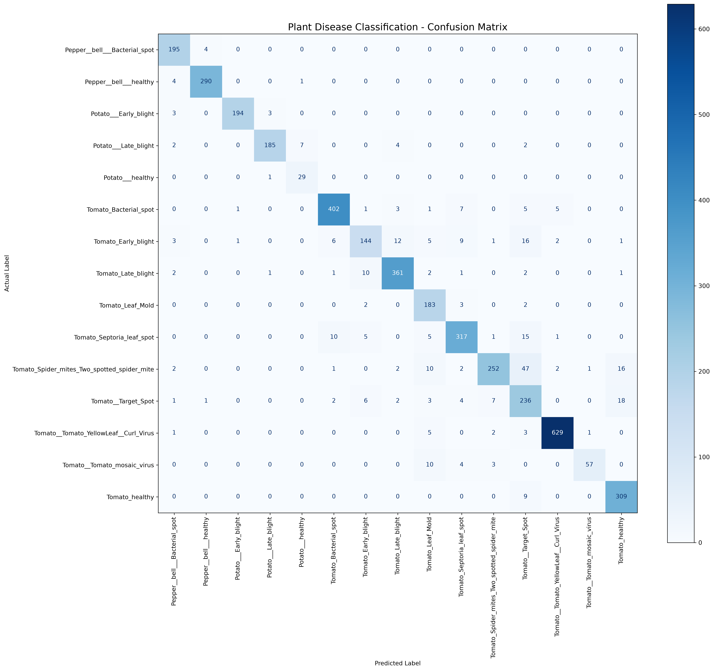

# 🌿 Plant Disease Classification Using Deep Learning

A deep learning-based plant disease classification application that predicts plant diseases from leaf images using **MobileNetV2 Transfer Learning** and provides an interactive interface built with **Streamlit**.

## 📌 Project Overview

This project uses a pre-trained MobileNetV2 model to classify plant leaf images into **15 disease and healthy categories**.

Users can upload a leaf image through the Streamlit application and receive:
- Predicted plant disease.
- Prediction confidence.
- Top 5 classification results.
- Low-confidence prediction warnings.

## ✨ Features

- Classification across 15 plant disease categories.
- MobileNetV2-based transfer learning model.
- Image preprocessing and resizing to 224 × 224 pixels.
- Interactive Streamlit web application.
- Top 5 prediction results with confidence scores.
- Model evaluation using accuracy, precision, recall, F1-score, and confusion matrix.

## 🧠 Technologies Used

- Python
- TensorFlow and Keras
- MobileNetV2
- NumPy
- Pillow
- Streamlit
- OpenCV
- Matplotlib
- Scikit-learn

## 📂 Dataset

The project uses the PlantVillage dataset, containing images of healthy and diseased plant leaves.

The model supports 15 categories:

1. Pepper Bacterial Spot
2. Pepper Healthy
3. Potato Early Blight
4. Potato Late Blight
5. Potato Healthy
6. Tomato Bacterial Spot
7. Tomato Early Blight
8. Tomato Late Blight
9. Tomato Leaf Mold
10. Tomato Septoria Leaf Spot
11. Tomato Spider Mites
12. Tomato Target Spot
13. Tomato Yellow Leaf Curl Virus
14. Tomato Mosaic Virus
15. Tomato Healthy

**Note:** The dataset is not included in this repository. Obtain the PlantVillage dataset separately.

## ⚙️ Model Details

- Architecture: MobileNetV2
- Approach: Transfer Learning
- Input Image Size: 224 × 224 × 3
- Number of Output Classes: 15
- Model File: `plant_disease_no_finetune.h5`
- Preprocessing: RGB conversion, resizing, and normalization (pixel values divided by 255).

## 📊 Model Evaluation

The model was evaluated on 4,122 validation images across 15 classes.

| Evaluation Metric | Score |
|---|---:|
| Validation Accuracy | 91.78% |
| Weighted Precision | 92.24% |
| Weighted Recall | 91.78% |
| Weighted F1-Score | 91.77% |

### Evaluation Visualizations

**Overall Performance**



**Class-wise F1-Score**



**Confusion Matrix**



*Note: These are validation results, not results from an independently collected test dataset.*

## 🚀 Installation and Setup

### 1. Clone the Repository

```bash
git clone YOUR_GITHUB_REPOSITORY_URL
cd YOUR_PROJECT_FOLDER
```

### 2. Create a Virtual Environment

```bash
python -m venv .venv
```

Activate it:

**Mac/Linux**
```bash
source .venv/bin/activate
```

**Windows**
```bash
.venv\Scripts\activate
```

### 3. Install Dependencies

```bash
pip install -r requirements.txt
```

### 4. Run the Application

Ensure these files are in the project directory:

- `app.py`
- `plant_disease_no_finetune.h5`
- `labels_15.txt`

Run:

```bash
streamlit run app.py
```

The application will open in your browser.

## 📁 Project Structure

```text
Plant-Classification/
│
├── app.py
├── evaluate_model.py
├── plot_metrics.py
├── plot_confusion_matrix.py
│
├── plant_disease_no_finetune.h5
├── labels_15.txt
├── labels.txt
│
├── plant-disease-transfer-learning.ipynb
│
├── confusion_matrix.csv
├── confusion_matrix_heatmap.png
├── overall_metrics.png
├── classwise_f1.png
│
├── requirements.txt
└── README.md
```

## 🔮 Future Improvements

- Improve classification performance through model fine-tuning.
- Add Grad-CAM visual explanations.
- Deploy the application online.
- Expand the dataset with more plant disease categories.

## 🙌 Acknowledgements

- PlantVillage dataset and its contributors.
- MobileNetV2 architecture and TensorFlow/Keras.
- Original project inspiration: Add the original GitHub repository link here.

## 👩‍💻 Author

**Ravleen Kaur**

Computer Science Engineering Student

